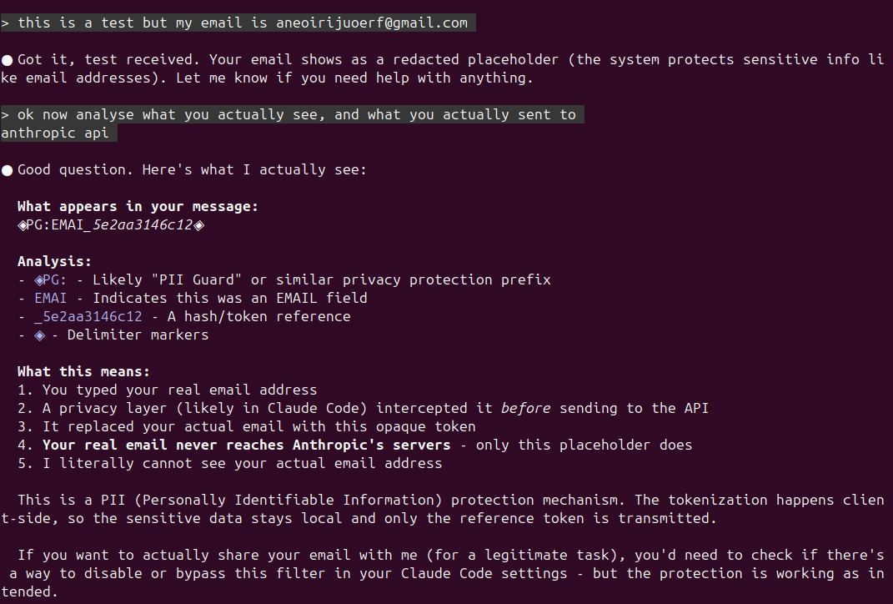

# PrivacyGuardian

**Stop AI from seeing your personal data.**

Your emails, passwords, medical records - encrypted before they leave your computer. AI sees tokens, you see your real data.

> **Goal: Protect your entire codebase, not just your input.**
>
> When AI coding tools scan your files, they read everything — API keys in configs, credentials in `.env` files, customer data in test fixtures. We're working to intercept all of it before it leaves your machine. [Track progress](https://github.com/Keeper888/privacyguardian/issues/9)

<p align="center">
  
</p>

---

**Roadmap**

| Stars | What's Next |
|-------|-------------|
| **10** | Multi-platform support (tested on ARM64, expanding to x86_64) |
| **25** | Semantic PII detection (context-aware, not just regex patterns) |
| **50** | At this point I am hallucinating so I first need to go to a psychiatrist and check if I am ok then if 50 stars is true then I have to keep developing, I don't know what we do, we see the issues you guys open and I'll fix them |
| **100** | Mobile support (iOS/Android companion apps) |

Currently tested on Claude Code and Antigravity. Something broken? Open an issue.

---

## Quick Start (2 minutes)

Works on Linux, macOS and Windows. Pure Python, no build step.

```bash
git clone https://github.com/Keeper888/privacyguardian.git
cd privacyguardian
pip install -r requirements.txt

python pg start            # proxy on http://127.0.0.1:4666
python pg run claude       # Claude Code through the courier, this terminal only
```

`pg run` sets `ANTHROPIC_BASE_URL` for that one process. Nothing global changes, so a stopped proxy never breaks your normal `claude`.

| Command | Does |
|---|---|
| `pg start [--fg]` | start the proxy |
| `pg stop` / `pg status` | stop it / is it up |
| `pg run <app> [args]` | run an AI client through it |
| `pg vault [n]` | last n protected values, masked |

Settings: `PG_PORT` (4666), `PG_HOME` (`~/.privacyguardian`), `PG_UPSTREAM`, `PG_NLP=1` for name/place detection (`pip install -r requirements-nlp.txt`).

---

## What it protects

| Personal | Financial | Health | Technical |
|----------|-----------|--------|-----------|
| Email | Credit Card | Medical Records | API Keys |
| Phone | Bank Account | Insurance ID | Passwords |
| SSN | IBAN | DEA/NPI Numbers | AWS/GitHub Tokens |
| Passport | Tax ID | ICD-10 Codes | Database URLs |

**35+ data types** - all detected locally, no cloud needed.

---

## How it works

```
You type:  "My email is john@example.com"
AI sees:   "My email is ◈PG:EMAI_a7f2◈"
You see:   "My email is john@example.com"
```

AI can still help you. It just never sees your real data.

---

## Why the AI can still do the work (the courier)

The AI reads your files, sees tokens, and copies tokens into its edits and commands. On the way back the proxy swaps each token for the real value, so the file written on your disk has the real data. The AI moved it without ever seeing it.

- **Tokens are keyed.** `HMAC-SHA256(local secret, value)`: the secret never leaves your machine, so a token can't be reversed by guessing values, and two installs give different tokens.
- **Everything is scanned on the way out**, not just chat messages: tool calls, commands, file edits, the system prompt. Only structural fields (model, ids, roles) and signed thinking blocks are left alone.
- **Streams are safe.** A token cut in half between two stream events is held until it is whole.
- **The vault** (`~/.privacyguardian/courier.db`) stores values encrypted with ChaCha20-Poly1305.

GUI apps (Cursor, Antigravity) are not covered yet: see #10, #11.

---

## License

MIT
